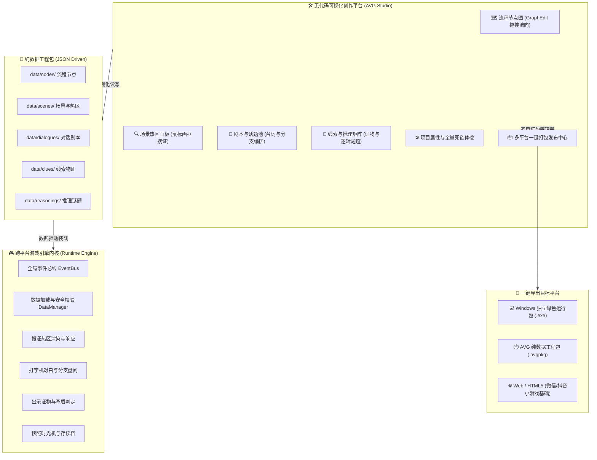

# MagicStar-Engine (魔星悬疑推理与视觉小说 AVG 引擎平台)

基于 **Godot 4 + GDScript + JSON 数据驱动** 打造的 **轻量级跨平台 2D 悬疑推理 AVG 游戏引擎** 与 **所见即所得可视化创作编辑器 (AVG Studio)**。

---

## 🌟 双核心产品架构

整个项目由两大核心支柱构成：



---

## 一、 目录结构规范

```text
E:\aigame/
├── project.godot                     # Godot 4.7 引擎配置文件
├── README.md                         # 本架构手册
│
├── editor/                           # 【创作者平台】AVG Studio 可视化编辑器
│   ├── core/
│   │   └── export_manager.gd         # 多平台打包与构建执行引擎
│   └── ui/
│       ├── editor_main.tscn          # 编辑器主界面
│       ├── editor_main.gd            # 创作平台调度逻辑与快捷键监听
│       ├── components/
│       │   └── hotspot_box.gd        # 场景画板交互式热区矩形（拖拽/缩放/高亮）
│       ├── tabs/
│       │   ├── flow_graph_tab.gd     # 🗺️ 流程节点图画布 (GraphEdit)
│       │   ├── scene_painter_tab.gd  # 🔍 场景搜证热区画板 (所见即所得画框)
│       │   ├── dialogue_tab.gd       # 📜 剧本台词卡片与话题池编辑器
│       │   ├── clue_reasoning_tab.gd # 🧩 线索档案库与逻辑推理矩阵
│       │   └── project_settings_tab.gd # ⚙️ 项目全局设置与全量死链体检
│       └── dialogs/
│           └── export_dialog.gd      # 📦 多平台一键导出发布对话框
│
├── engine/                           # 【引擎内核】跨平台通用运行时播放器
│   ├── core/
│   │   ├── event_bus.gd              # 全局解耦事件总线
│   │   ├── data_manager.gd           # JSON 数据加载、动态修改与持久化
│   │   ├── condition_checker.gd      # 表达式求值器 (has_clue 等)
│   │   └── game_state.gd             # 状态存储与快照时光机
│   └── systems/
│       ├── node_manager.gd           # 故事状态机 (支持指定节点极速试玩)
│       ├── clue_manager.gd           # 证物档案与分类筛选
│       ├── dialogue_manager.gd       # 台词翻页、打字机跳过与话题池
│       ├── explore_manager.gd        # 2D 搜证热区响应
│       ├── reasoning_manager.gd      # 疑问驱动的出示举证与个性化错误反馈
│       └── save_manager.gd           # 纯数据快照存读档
│
├── scenes/                           # 【表现层场景】
│   ├── launcher.tscn                 # 🌟 模式选择启动器 (创作器 vs 游戏试玩)
│   ├── launcher.gd
│   ├── main.tscn                     # 游戏运行时主界面 (玩家视角)
│   └── main.gd                       # 界面响应与键盘/鼠标推进交互
│
├── config/                           # 【项目全局配置】
│   ├── game_config.json              # 游戏标题、版本号、主人公姓名
│   └── flow_config.json              # 起始节点定义 (start_node) 与时间线
│
├── data/                             # 【剧情数据层】纯 JSON 内容驱动
│   ├── nodes/                        # 故事流程节点
│   ├── scenes/                       # 场景背景与搜证热区配置
│   ├── dialogues/                    # 剧本台词与 NPC 盘问池
│   ├── clues/                        # 案情线索物证库
│   ├── reasonings/                   # 逻辑推理与矛盾反驳谜题
│   └── endings/                      # 结局分支
│
└── assets/                           # 【媒体资源层】图片立绘、背景与音频
    ├── images/ (backgrounds/, characters/)
    └── audio/ (bgm/, sfx/)
```

---

## 二、 创作者核心工作流 (AVG Studio)

启动游戏或在终端运行：
```powershell
godot "res://scenes/launcher.tscn"
```
选择 **【🛠️ 启动 AVG Studio】** 即可进入可视化创作工作台。

### 1. 🗺️ 故事流程节点图 (Flow Graph)
* **直观网状关系**：基于 Godot 原生 `GraphEdit`，卡片清晰展示剧情节点 (`story`)、搜证现场 (`explore`)、推理环节 (`reasoning`) 与结局 (`ending`)。
* **拖拽连线**：拖拽右侧圆点到其他节点即可完成分支或流向绑定，无需编写代码。
* **极速试玩**：每个节点卡片均提供 **【▶ 试玩该节点】** 按钮，无需从头跑剧情，直接针对当前设计进行调试验证。

### 2. 🔍 场景搜证热区画板 (Scene Hotspot Painter)
* **所见即所得画框**：点击 **【✏️ 鼠标画框新建热区】**，直接在背景图上拖拽拉框即可生成搜证点。
* **交互手柄**：支持直接在画板上拖动移动位置、拖动右下角黄色手柄无级缩放尺寸。
* **智能归一化**：自动将像素转换为自适应任何屏幕分辨率的 `[x, y, w, h]` 归一化坐标。
* **事件属性绑定**：在右侧面板下拉点选调查类型（获得线索、触发对白、跳转节点），支持配置“需先获得某线索才可见”的前置条件。

### 3. 📜 剧本台词与 NPC 话题池 (Dialogue Editor)
* **卡片式剧本流**：直观展示说话人、台词内容、排序调整（上移/下移）。
* **分支与选项**：无缝配置玩家选择分支及跳转流向。

### 4. 🧩 线索库与推理矩阵 (Clue & Reasoning Matrix)
* **线索档案录入**：快速录入物证、证言与现场痕迹，指定来源与侦破提示。
* **逆转裁判式举证推理**：可视化配置破绽疑问（Question）、勾选必须出示的正确线索（Required Clues）、并可为玩家出示错误的特定线索配置专属指引台词（Error Hints）。

### 5. 🩺 全量数据一致性体检
* 一键扫描整部作品，自动检测并高亮：
  * 起始节点是否有效；
  * 是否存在指向不存在节点或场景的**死链**；
  * 推理谜题依赖的线索是否缺失；
* 彻底杜绝因配置遗漏导致的运行时报错。

---

## 三、 📦 多平台一键打包发布指南

在 AVG Studio 顶部点击 **【📦 多平台打包发布】**，可选择：

### 1. 💻 Windows 独立桌面发行包 (.exe)
* 自动化打包生成纯绿色可运行文件夹：包含已适配好的可执行程序、启动脚本与独立游戏数据目录。
* 创作者可直接压缩成 zip 发给测试玩家，玩家**无需安装 Godot 即可双击直接运行！**

### 2. 📦 AVG 纯数据工程发布包 (.avgpkg)
* 提取 `data/` 与 `config/` 自动生成独立的 `.avgpkg` 压缩包。
* 适合用于：创作者之间共享案件剧本、线上 DLC/MOD 扩展、或通过网络进行热更新。

### 3. 🌐 Web / 微信 / 抖音小游戏规范适配
* 基于 HTML5 导出预设，引擎已做好触控/鼠标统一输入与全分辨率动态缩放，可平滑挂载至小游戏容器外壳。

---

## 四、 常用快捷键

| 快捷键 | 功能说明 |
| :--- | :--- |
| **F5** | 在 AVG Studio 中一键启动全流程试玩进程 |
| **Ctrl + S** | 快速保存所有标签页的修改 |
| **空格 / 回车 / 鼠标左键** | 游戏运行中快速推进对话 / 跳过打字机动画 |
| **Esc / 顶部栏按钮** | 呼出线索笔记本、案件脉络时光机或切换模式 |
