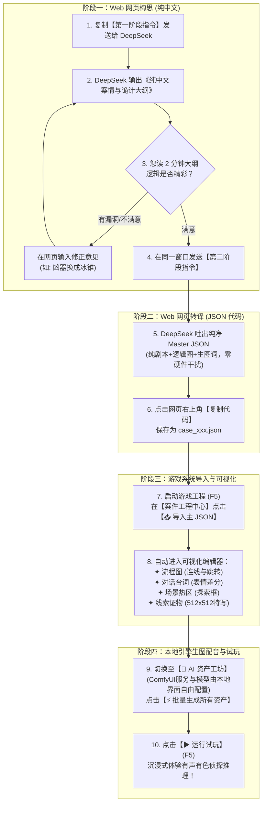

# MagicStar AVG 引擎 · AI 全案剧本生成与导入实战手册 (v5.1 解耦纯净版)

> 本手册为**人类创作者与 Web 网页端 AI（DeepSeek / ChatGPT / Claude）**协同创作的标准化操作指南（SOP）。
> **彻底剥离本地硬件参数**：ComfyUI 服务器 IP、底模名称等硬件配置完全由引擎本地管理，不再要求剧本 AI 输出任何硬件参数！AI 100% 聚焦于本格推理剧情、逻辑状态机与视听素材描述。

---

## 目录
- [一、全流程总览拓扑图](#一全流程总览拓扑图)
- [二、阶段一：构思案情大纲（纯中文，不碰代码）](#二阶段一构思案情大纲纯中文不碰代码)
- [三、阶段二：转译 Master JSON（一键编译）](#三阶段二转译-master-json一键编译)
- [四、阶段三：保存文件并导入游戏系统](#四阶段三保存文件并导入游戏系统)
- [五、阶段四：在系统里可视化检阅与编辑](#五阶段四在系统里可视化检阅与编辑)
- [六、阶段五：AI 资产工坊批量生图与配音](#六阶段五ai-资产工坊批量生图与配音)
- [七、阶段六：运行试玩与沉浸式破案](#七阶段六运行试玩与沉浸式破案)
- [八、进阶技巧：在系统修改后如何安全回传 AI 润色](#八进阶技巧在系统修改后如何安全回传-ai-润色)
- [附录：八大大师画风与音色代码速查表](#附录八大大师画风与音色代码速查表)

---

## 一、全流程总览拓扑图



---

## 二、阶段一：构思案情大纲（纯中文，不碰代码）

### 1. 操作步骤
1. 打开浏览器，访问 **DeepSeek 网页版**（或 ChatGPT / Claude）。
2. 新建一个对话窗口。
3. 复制下方的**【第一阶段提示词】**，在提示词开头填入您构思的**题材**和挑选的**画风**，发送给 AI。

### 2. 第一阶段提示词模板（直接复制）

```markdown
你是一名世界级的本格派推理 AVG（视觉小说）主编剧。
请为我构思一个扣人心弦、逻辑严密、无物理漏洞的侦探推理案件剧本大纲。

【定制需求】：
- 故事题材：（例如：暴风雪孤岛灯塔密室 / 暴风雨深夜豪华列车 / 废弃歌剧院魅影 / 大理寺古风断案）
- 画风基调：（从以下挑选：宫崎骏吉卜力风 / 欧美奇幻写实 / 日式二次元和风 / 中式国风仙侠 / 卡通Q版 / 暗黑克苏鲁 / 像素复古 / 水彩手绘）

【必须按以下中文结构输出案件大纲（不要输出任何 JSON 或代码）】：
1. 【案情概述与舞台】：
   - 案发地点、时代背景与死者身份
   - 案发第一现场惨状与官方初步死因
2. 【核心诡计与作案手法（本格推理精髓）】：
   - 现场不可能犯罪的表象（如：从内侧反锁的绝对密室、暴风雪中无足迹雪地）
   - 凶手实际利用的物理/机械/心理机制（请确保科学常识上完全说得通，严禁反常识神棍）
3. 【登场人物档案（侦探 + 3位嫌疑人）】：
   - 姓名、年龄、身份职业、外貌标志性特征（发型、标志服饰、配饰）
   - 每位嫌疑人的动机、表面上的不在场证明
4. 【现场搜查场景与物证链（2~3个场景，共 3~5 个物证）】：
   - 场景名称及环境中散落的物证
   - 核心物证的物理特征，以及它如何推翻凶手的谎言
5. 【对质破谎与推演高潮】：
   - 面对侦探质询时，真凶说出的致命破绽台词
   - 侦探出示哪样物证，彻底瓦解真凶的防御
6. 【结局分支】：
   - 真结局（揭穿真相后的落幕感悟）
   - 假结局（若侦探推理错误抓错人的悲剧结局）

请先为我构思并输出这份纯中文的案件设计大纲。
```

### 3. 人类审阅技巧（把关 2 分钟）
* **看物理常识**：比如“零下二十度用冰块机关，但灯塔里点着大火炉”，如果出现这种冲突，直接在聊天框回复：*“灯塔里有炉火，冰块会提前融化，请把作案手法改成利用钢丝与平衡重锤的机械延迟装置”*。
* **看嫌疑人谎言**：确保凶手露出的马脚是合乎情理的，而不是强行犯蠢。
* 满意后，**不要新建聊天**，直接进入第二阶段！

---

## 三、阶段二：转译 Master JSON（一键编译）

### 1. 操作步骤
在大纲满意后，在**同一个 DeepSeek 聊天窗口**中，直接复制下方的**【第二阶段提示词】**发送。

### 2. 第二阶段提示词模板（直接复制）

```markdown
非常好！我对上方确认的案件大纲非常满意。
现在，请你扮演资深游戏关卡架构师，将上方我们已经敲定的案件大纲，100% 严格转译为符合 MagicStar AVG 引擎规范的单文件 Master JSON。

【核心转译规范（严禁违反）】：
1. 【输出格式】：必须输出纯 JSON，使用 ```json ... ``` 包裹，不要在前后附带任何多余闲聊说明。
2. 【根对象结构】：必须且仅需包含 meta, flow_config, game_config, characters, scenes, clues, nodes, dialogues, reasonings, endings 字典。（注意：不要输出任何硬件或服务器连接参数！）。
   - meta 必须包含 "project_id"（英文唯一文件夹名）、"game_title"（中文标题）、"author"、"description"、"style_preset"（如 ghibli）。
   - flow_config 必须包含 "start_node": "node_01_intro"。
   - game_config 包含 "protagonist_name": "侦探姓名"。
3. 【节点状态机规范 (nodes)】：
   - 必须通过 "next" 字段形成连贯的流程链条：story 节点（开场剧情）➔ explore 节点（现场搜查）➔ reasoning 节点（证据推演）➔ ending 节点（结局）。
   - 每个 story / explore / reasoning / ending 节点必须指定 "scene": "场景ID"。
   - story 节点必须配置 "dialogue": "对白ID"。
   - reasoning 节点必须配置 "reasoning": "推演ID"。
   - ending 节点必须配置 "ending": "结局ID"。
4. 【严格尺寸与专属正反向提示词】：
   - characters (立绘): "size": [512, 768]，prompt 必须锁定大纲中的外貌服装锚点，末尾带 "waist-up portrait, standing pose, white background"；negative_prompt 必须带 "(background:1.3), complex background, extra limbs, bad hands"。
   - scenes (场景背景): "size": [1920, 1080]，prompt 必须按三段分区（左/中/右）描写环境物体，末尾带 "highly detailed, scenery, no humans"；negative_prompt 必须带 "(humans, people, character:1.4), text, watermark, blurry"。
   - clues (物证特写卡片): "size": [512, 512]，prompt 必须描写单个证物微距特写，末尾带 "single object, centered, macro close-up shot, dramatic lighting, isolated"；negative_prompt 必须带 "humans, hands, cluttered, text"。
5. 【场景探索点与方位对齐】：scenes.explore_points 中的 rect 必须是 0.0 到 1.0 的相对比例 [x, y, w, h]，且 x 坐标必须与 scene prompt 中描写的方位对应（左区 0.05~0.35，中区 0.35~0.65，右区 0.65~0.95）。探索点触发的 target 必须是 clues 中真实存在的物证 ID（"trigger": { "action": "clue", "target": "物证ID" }）！
6. 【说话人与立绘严格绑定】：dialogues 中每一句台词的 "speaker" 必须与 characters 中定义的中文 "name" 完全一致（旁白填 "旁白"，主角填主角名）。
7. 【表情与配音情绪联动】：dialogues 中的每句台词必须附带 "expression"（可选: normal, nervous, shocked, angry, sad, confident）。
8. 【配音音色指定】：characters 中每个角色需配置 "voice"（可选音色：青年男 "zh-CN-YunxiNeural"、沉稳大叔 "zh-CN-YunjianNeural"、温柔女 "zh-CN-XiaoxiaoNeural"、少女 "zh-CN-XiaoyiNeural"、旁白 "zh-CN-YunyangNeural"）。
9. 【线索逻辑严格闭环】：reasonings 中 required_clues 要求的每一个线索 ID，必须在 clues 中定义，且必须能在前面的 scenes.explore_points 中被玩家调查收录！
10. 【双语规范】：剧本名、人名、台词、线索标题与描述全部使用地道精彩的【简体中文】；所有 prompt 和 negative_prompt 必须输出高质量的【英文】。

请根据我们敲定的大纲，直接输出最终的完整纯净 Master JSON。
```

---

## 四、阶段三：保存文件并导入游戏系统

### 1. 本地保存 JSON 文件
1. 在 DeepSeek 网页端输出的 JSON 代码块右上角，点击 **【复制代码】（Copy）**。
2. 在您的电脑任意位置（例如桌面或项目目录 `E:\aigame\` 下），新建一个文本文档。
3. 将内容粘贴进去，保存为 `.json` 文件，例如：`case_orient_express.json`。

### 2. 导入到 MagicStar 引擎中
1. 打开 Godot 编辑器，按 **F5** 运行游戏。
2. 在弹出的 **【案件工程中心 (Project Hub)】** 窗口中：
   * 点击右侧绿色的 **【📥 导入主 JSON 创建项目】** 按钮。
   * 在文件选择弹窗中，选中您刚刚保存的 `.json` 文件，点击确定。
3. **系统自动动作**：
   * 引擎会在 `res://projects/` 下自动以 `project_id` 创建一个独立的工程文件夹（如 `res://projects/case_orient_express/`）。
   * 自动校验全部字段，并将该案件设为当前活动工程。
   * 界面自动切换进入主可视化编辑器！

---

## 五、阶段四：在系统里可视化检阅与编辑

导入成功后，系统顶部的各个功能标签页已经全部为您点亮：

| 标签页名称 | 可视化呈现内容 | 您可以在这里做什么？ |
| :--- | :--- | :--- |
| **📈 流程图 (Flow Graph)** | 剧情所有节点（开场剧情、现场搜证、推演、结局）的有向图连线 | 鼠标拖拽排布节点卡片，检查节点之间的箭头连接是否顺畅，双击节点查看详情。 |
| **💬 对话编辑 (Dialogue)** | 剧本对白列表、人物说话人与头像预览 | 逐句阅读剧本台词，点击台词直接就地修改文本错别字，切换角色表情（nervous/angry 等）。 |
| **🔍 搜证场景 (Scenes)** | 案发现场背景大图与场景探索点分布 | 直观查看探索框位置。用鼠标按住探索框的边角可以**自由拖拽缩放热区范围**，绑定线索。 |
| **💼 线索物证 (Clues)** | 案件所有物证的特写图片与描述列表 | 查看物证详情、修改证物中文名称与调查说明。 |

---

## 六、阶段五：AI 资产工坊批量生图与配音

当您在可视化界面确认剧本内容无误后，就可以一键为游戏注入美术与声音：

1. 点击顶部标签页切换到 **【🎨 AI 资产工坊 (AI Asset)】**。
2. **确认/调整本地硬件配置**（全在界面上操作，与剧本彻底解耦）：
   * **ComfyUI 服务器**：在顶部输入框填入您的本地或局域网地址（默认 `http://127.0.0.1:8188` 或 `http://192.168.1.57:8188`）。
   * **底模 Checkpoint**：填入您本地 ComfyUI 安装的大模型（如 `toonyou_beta6.safetensors`）。
   * **风格模板**：在下拉菜单中任意挑选 8 大画风（自动填充风格修饰词与负向词）。
   * 点击 **【💾 保存 AI 配置】**，该配置永久保存在本地，无需每次重复设置！
3. **一键全案生成**：
   * 点击右上方绿色的 **【⚡ 批量生成所有资产】**（或在左侧列表选中单项点击生成）。
   * **底层自动执行**：
     * **场景背景**：生成 `1920x1080` 高清环境图并自动保存到案件目录。
     * **角色立绘**：生成 `512x768` 肖像，并**自动调用 AI 抠图算法进行发丝级去底**，输出免抠透明 PNG！
     * **物证卡片**：生成 `512x512` 居中正方形物证特写大图。
     * **角色配音**：自动提取剧本中所有对白，根据 `expression` 情绪（紧张/愤怒/悲伤）自动调节语速音调，生成 Edge-TTS 配音音频！

---

## 七、阶段六：运行试玩与沉浸式破案

1. 资产生成完成后，直接点击右上角的 **【▶ 运行试玩】**（或在 Godot 中按 **F5**）。
2. **享受沉浸式侦探体验**：
   * 聆听随着人物情绪起伏的角色配音；
   * 看到在特定画风下生动呈现的透明角色立绘与背景；
   * 在搜证场景中点击调查热区，弹出高清物证特写卡片；
   * 在对质环节出示关键证据，击碎凶手的密室谎言！

---

## 八、进阶技巧：在系统修改后如何安全回传 AI 润色

如果您在引擎界面里手动增删了几个探索点或台词，希望让 DeepSeek 帮您把整体文笔润色得更有戏剧张力：

1. 在系统界面左上角点击 **【导出项目主 JSON】**，将最新内容复制出来。
2. 打开 DeepSeek，发送以下**【安全局部润色指令】**（带安全护栏，绝不破坏底层结构）：

```markdown
这是我目前的游戏工程 JSON。请在【绝对不修改任何原有数据结构】的前提下，帮我润色剧本对白：
【安全铁律】：
1. 严禁修改、删除或重命名任何 id、rect、scene、size、node、next 字段！
2. 严禁改动任何生图提示词 (prompt)！
3. 你【唯一被允许修改的内容】，只有 dialogues 字典中每一句对白的 "text" 文本！请将台词润色得更加扣人心弦、充满悬疑推理张力！

[在此粘贴您的 JSON]
```

---

## 附录：八大大师画风与音色代码速查表

### 1. 画风代码（填写在 `meta.style_preset` 或在系统下拉菜单中选择）
* `ghibli`：🌿 宫崎骏 / 吉卜力手绘风
* `western_fantasy`：🏰 欧美奇幻 / 写实风
* `japanese_wafuu`：⛩️ 日式二次元 / 和风
* `chinese_guofeng`：🏮 中式国风 / 仙侠水墨
* `cute_chibi`：🧸 卡通风 / Q版萌系
* `dark_cthulhu`：👁️ 暗黑 / 恐怖 / 克苏鲁
* `pixel_retro`：👾 像素 / 复古 16-bit
* `watercolor_art`：🎨 水彩 / 手绘 / 艺术画风

### 2. 角色配音音色代码（填写在 `voice`）
* `zh-CN-YunxiNeural`：活泼青年男声 / 年轻侦探 / 助手学徒
* `zh-CN-YunjianNeural`：沉稳大叔男声 / 老管家 / 资深刑警
* `zh-CN-XiaoxiaoNeural`：温暖知性女声 / 遗孀 / 女侦探
* `zh-CN-XiaoyiNeural`：清脆少女声 / 年轻千金 / 女仆
* `zh-CN-YunyangNeural`：沉着浑厚旁白音 / 纪录片解说
