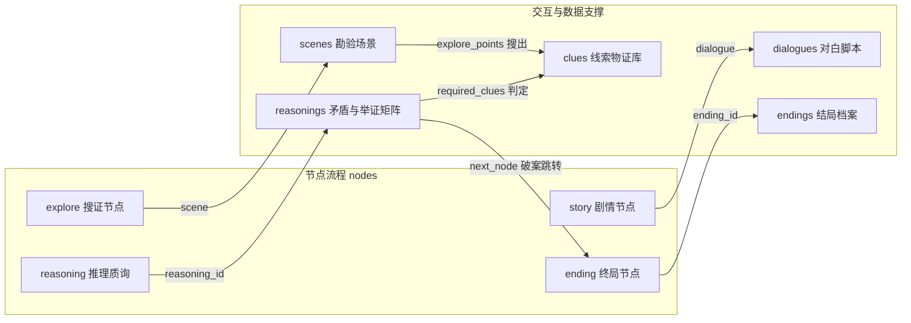

# MagicStar AVG 引擎 · 第三方 AI 全案故事生成规范手册
> 本手册用于指导第三方大模型（Claude、ChatGPT、DeepSeek 等）一次性生成 100% 兼容本引擎的案件总工程 JSON。

---

## 一、系统运作流程概览

```mermaid
flowchart TD
    Prompt[给第三方 AI 的故事提示词] --> LLM[第三方大模型]
    LLM --> JSON[生成案情总工程 JSON]
    JSON --> Hub[案件工程中心: 📥 导入 AI 故事 JSON]
    Hub --> Proj[自动创建工程 & 目录结构: res://projects/case_xxx/]
    Proj --> Editor[可视化编辑器: 故事图 / 搜证 / 推理]
    Editor --> ComfyUI[🎨 AI 资产工坊: 连接本地 ComfyUI 批量生图]
    ComfyUI --> Play[▶ 运行试玩 (F5): 完整有声有色推理破案]
```

---

## 二、核心数据结构与关系链路

本引擎遵循**完全数据驱动、无代码死链**原则。整个游戏所有逻辑必须闭环互锁：



---

## 三、各模块详细字段定义规范

### 1. `meta` (案件工程元数据)
| 字段名 | 类型 | 必填 | 说明 |
| :--- | :--- | :---: | :--- |
| `project_id` | String | 是 | 唯一英文工程代号（如 `case_03_orient_express`），将作为文件夹名 |
| `game_title` | String | 是 | 案件中文标题（如 `东方快车雪夜谋杀案`） |
| `author` | String | 是 | 创作者/制作组名称 |
| `description` | String | 是 | 案情背景简介（100-300字） |

### 2. `ai_settings` (本地 ComfyUI 算力与画风配置)
```json
"ai_settings": {
  "comfyui_server": "http://192.168.1.57:8188",
  "checkpoint": "toonyou_beta6.safetensors",
  "global_style_prompt": "masterpiece, best quality, anime visual novel, dark mystery, cinematic dramatic lighting",
  "global_negative_prompt": "worst quality, low quality, blurry, text, watermark, bad anatomy, deformed limbs",
  "character_base_prompt": "solo, waist-up portrait, standing pose, white background",
  "bg_base_prompt": "scenery, background, highly detailed, no humans"
}
```

### 3. `characters` (登场人物档案)
每个角色的 Key 为唯一 ID（如 `char_detective`）：
| 字段名 | 类型 | 必填 | 说明 |
| :--- | :--- | :---: | :--- |
| `id` | String | 是 | 角色唯一英文 ID |
| `name` | String | 是 | 角色中文姓名（如 `林探长`） |
| `identity` | String | 是 | 身份职业（如 `私家侦探`、`古宅管家`、`死者妻子`） |
| `prompt` | String | 是 | **英文生图提示词**（包含性别、发型发色、服装、神态，半身构图） |

### 4. `clues` (线索与物证档案)
每个线索的 Key 为唯一 ID（如 `clue_broken_clock`）：
| 字段名 | 类型 | 必填 | 说明 |
| :--- | :--- | :---: | :--- |
| `id` | String | 是 | 线索唯一英文 ID |
| `title` | String | 是 | 物证中文名称（如 `卡死的古董落地钟`） |
| `description` | String | 是 | 物证细节、破案破绽说明（如 `指针停在23点15分，内部齿轮卡死`） |
| `type` | String | 是 | 固定取值：`item` (现场物证) 或 `testimony` (证人口供) |

### 5. `scenes` (搜证勘验场景)
每个场景对应一张 1920x1080 背景图，包含若干个现场点击交互热点：
| 字段名 | 类型 | 必填 | 说明 |
| :--- | :--- | :---: | :--- |
| `id` | String | 是 | 场景唯一 ID（如 `scene_study`） |
| `name` | String | 是 | 场景中文名称（如 `豪宅二楼书房`） |
| `prompt` | String | 是 | **英文背景生图提示词**（包含空间、环境光影、天气细节，无人物） |
| `explore_points` | Array | 是 | 可勘验热点列表（见下表） |

**`explore_points` 交互热点对象属性**：
- `id`: 热点唯一 ID（如 `point_clock`）
- `name`: 热点交互浮窗中文名称（如 `🕰️ 停摆的落地钟`）
- `rect`: **归一化矩形坐标** `[x, y, w, h]`，取值范围必须在 `0.0` 到 `1.0` 之间。
  - 例如 `[0.1, 0.2, 0.2, 0.5]` 表示位于左侧 10%、顶部 20%、宽 20%、高 50% 的区域。
- `type`: `once`（调查一次即收录线索）或 `repeatable`（可反复点击对话）。
- `trigger`: 触发结果。格式：`{"action": "clue", "target": "clue_broken_clock"}`。

### 6. `nodes` (流程图流转节点)
驱动游戏从序幕推进到终局的骨架。每个节点必须具备：
- `id`: 节点唯一 ID（如 `node_01_intro`）
- `title`: 节点中文标题（如 `序幕：雨夜抵达`）
- `type`: 节点类型（`story` / `explore` / `reasoning` / `ending`）
- 依据类型的关联属性：
  - 若 `type == "story"`: 必须配 `dialogue`（对白ID）与 `next`（目标节点ID）
  - 若 `type == "explore"`: 必须配 `scene`（场景ID）与 `next`（目标节点ID）
  - 若 `type == "reasoning"`: 必须配 `reasoning_id`（推理矩阵ID）
  - 若 `type == "ending"`: 必须配 `ending_id`（结局ID）

### 7. `dialogues` (剧本台词文本)
包含多句顺序对话。每句对白 `lines` 包含：
- `speaker`: 说话人角色名（如 `林探长`、`管家`、`旁白`）
- `text`: 对话正文内容
- `character_image`: (可选) 角色立绘素材关联

### 8. `reasonings` (推理举证判定矩阵)
玩家当面对质或在举证台上破案时的判定逻辑：
| 字段名 | 类型 | 必填 | 说明 |
| :--- | :--- | :---: | :--- |
| `id` | String | 是 | 推理唯一 ID（如 `reason_alibi_break`） |
| `title` | String | 是 | 辩论题目（如 `击溃午夜十二点的虚假不在场证明`） |
| `question` | String | 是 | **侦探质询问题**（如 `管家坚称午夜12点听到大钟敲响，哪个物证能证明他在撒谎？`） |
| `required_clues` | Array | 是 | **必破谎言的正确线索 ID 列表**（如 `["clue_broken_clock"]`） |
| `error_hints` | Object | 否 | 出示错误线索时的驳回台词，如 `{"clue_teacup": "茶杯药粉只能证明昏睡，不能证明时钟停摆！"}` |
| `next_node` | String | 是 | 举证成功后推进到的下一节点 ID |

### 9. `endings` (结局档案)
| 字段名 | 类型 | 必填 | 说明 |
| :--- | :--- | :---: | :--- |
| `id` | String | 是 | 结局唯一 ID（如 `ending_truth`） |
| `title` | String | 是 | 结案标题（如 `🎉 案情告破：第十三钟声的终结`） |
| `description` | String | 是 | 案件复盘与终局结语（交代真凶动机、手法与结局真相） |

---

## 四、高频踩坑与防呆校验规则（必须告知第三方 AI）

1. **绝对不要产生未闭合的死链**：
   - `nodes` 中引用的 `dialogue`、`scene`、`reasoning_id`、`ending_id` 必须在对应的 `dialogues`、`scenes`、`reasonings`、`endings` 字典中真实存在。
   - `reasonings.required_clues` 中的每一个线索 ID，必须在 `clues` 字典中存在，且必须能在前面的 `scenes.explore_points` 中被玩家搜查获取到！
2. **场景坐标必须在 0.0 ~ 1.0 之间**：
   - 交互点 `rect: [x, y, w, h]` 中所有数值必须在 0.0 到 1.0 之间，严禁使用 1920、1080 等绝对像素值。
3. **英文生图提示词要求**：
   - 所有场景背景的 `prompt` 必须只描述建筑室内外环境与光影，末尾必须包含 `highly detailed, no humans`（严禁背景里出现人物，否则会与立绘冲突）。
   - 所有角色立绘的 `prompt` 必须为腰部以上半身像，末尾必须包含 `waist-up portrait, standing pose, white background`。

---

## 五、直接复制给第三方 AI 的 Prompt 提示词模板

将以下提示词完整发给 Claude、ChatGPT 或 DeepSeek：

```markdown
你是一名世界级的本格派推理 AVG（视觉小说）主策划与主编剧。
请根据我指定的故事设定，输出一个 100% 符合 MagicStar AVG 引擎标准的单文件完整案件 Master JSON。

【核心要求】：
1. 必须输出合法可解析的纯 JSON，不要在 JSON 之外添加多余说明。
2. 逻辑严密无死链：故事必须包含完整的【序章对话 -> 现场搜证调查 -> 发现物证 -> 当面对质举证击破谎言 -> 结案真相反转】。
3. 搜证场景的 explore_points 坐标必须是 0.0~1.0 的相对比例 [x, y, w, h]。
4. 场景背景与角色的 prompt 必须为纯英文 Stable Diffusion 提示词，符合高质量动漫视觉小说渲染标准。
5. 必须包含完整的 meta, characters, clues, scenes, nodes, dialogues, reasonings, endings 字典。

【案件设定需求】：
- 故事题材：（例如：暴风雪孤岛音乐厅，钢琴家在密室演奏厅内遇害）
- 核心诡计：（例如：利用定时录音机制造死亡时间假象，死者血型与琴键血迹不符）
- 登场角色：（例如：神代侦探、剧场经理、小提琴手、随行医生）

请立即生成符合规范的完整 JSON。
```
