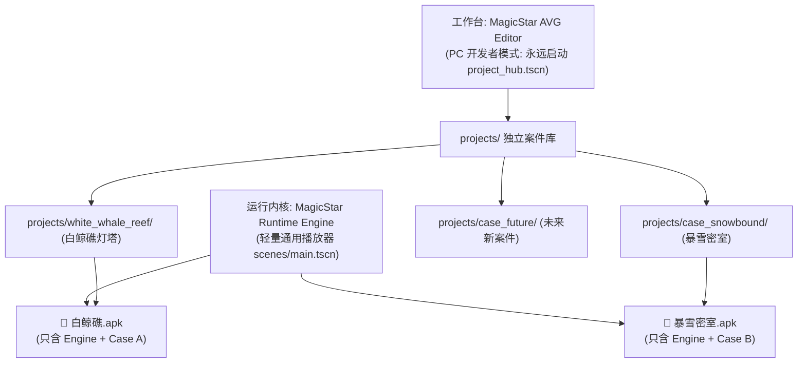

# MagicStar AVG 引擎 · 独立游戏多案件发布与导出手册 (v1.0)

> 本手册指导您如何在保持 **MagicStar AVG Editor** 开发主工程不变的前提下，将任意选定的**具体单个游戏（案件）**独立打包为纯净的 Android APK 安装包，确保**不携带编辑器代码、不携带其他无关游戏素材**。

---

## 一、三层解耦架构设计



* **Editor（编辑器）**：您的电脑主工程永远叫 `MagicStar AVG Editor`，启动永远是工程中心，绝不受任何单个游戏污染。
* **Engine（运行时）**：轻量播放器内核（`engine/` 与 `scenes/main.tscn`），移动端自动隐藏开发者按钮。
* **Content（案件包）**：`res://projects/` 下的各个案件是独立的资产包，导出时通过**资源过滤器**只打包选中的那一个。

---

## 二、如何为新游戏配置专属的导出预设

如果您在编辑器里新做了一个游戏（例如《东方快车谋杀案》），只需在 Godot 中为其添加一个专属导出预设：

### 1. 打开导出窗口
在 Godot 菜单栏点击：**【项目 (Project)】➔ 【导出 (Export...)】**。

### 2. 添加专属预设
1. 点击左上角 **【添加... (Add...)】➔ 【Android】**；
2. 将左侧新预设的名称改为：`Android - 东方快车谋杀案`。

### 3. 配置应用信息（在右侧【选项 (Options)】面板）
* **Package ➔ Name**：输入游戏显示中文名，如 `东方快车谋杀案`；
* **Package ➔ Unique Name**：输入独立英文包名，如 `com.magicstar.orientexpress`；
* **Keystore ➔ Debug**：选择 `C:/Users/63637/AppData/Roaming/Godot/keystores/debug.keystore`；
  * Debug User 填 `androiddebugkey`；
  * Debug Password 填 `android`；
* **Screen ➔ Orientation**：选 `Landscape`（横屏）；
* **Screen ➔ Immersive Mode**：打勾 ✅（全屏沉浸）。

### 4. 关键：设置资产隔离过滤（避免打包其他游戏）
在右侧切换到 **【资源 (Resources)】** 标签页（或在预设属性中设置过滤器）：
* **导出过滤器 (Export Mode)**：选择 `导出所有资源 (Export all resources in the project)`；
* **排除过滤器 (Exclude filter)**：输入需要排除的目录（用英文逗号分隔）：
  ```text
  editor/*, projects/white_whale_reef_lighthouse_master/*, projects/case_snowbound_lighthouse/*
  ```
  *(即：排除掉编辑器目录，以及所有不是《东方快车》的其它案件目录！)*

### 5. 指定独立启动目标
在项目根目录的 `default_project.txt` 文件中，写入该游戏的路径：
```text
res://projects/case_orient_express/
```

### 6. 一键导出
* 点击右下角 **【导出项目 (Export Project...)】**；
* 保存路径选择：`builds/orient_express.apk`；
* 导出完成！打出来的 APK 体积纯净，只包含《东方快车》的内容！

---

## 三、当前已就绪的预设速查

系统目前已为您自动配置好以下现成预设：

| 预设名称 | 目标案件 | 打包输出文件 | 过滤状态 |
| :--- | :--- | :--- | :--- |
| **`Android - 白鲸礁灯塔密室`** | `white_whale_reef_lighthouse_master` | [`builds/white_whale_reef.apk`](file:///E:/aigame/builds/white_whale_reef.apk) | 已排除 `editor/` 和其他旧案件，纯净打包 |

---

## 四、核心配置文件一览表

* **主工程入口与名称**：[`E:\aigame\project.godot`](file:///E:/aigame/project.godot)
  * `config/name = "MagicStar AVG Editor"`（工程名始终为编辑器）
  * `run/main_scene = "res://scenes/project_hub.tscn"`（电脑上启动永远是工程中心）
  * `run/main_scene.mobile = "res://scenes/main.tscn"`（打包成手机 APK 自动直入游戏）
* **多游戏导出预设**：[`E:\aigame\export_presets.cfg`](file:///E:/aigame/export_presets.cfg)
* **当前独立游戏指针**：[`E:\aigame\default_project.txt`](file:///E:/aigame/default_project.txt)
